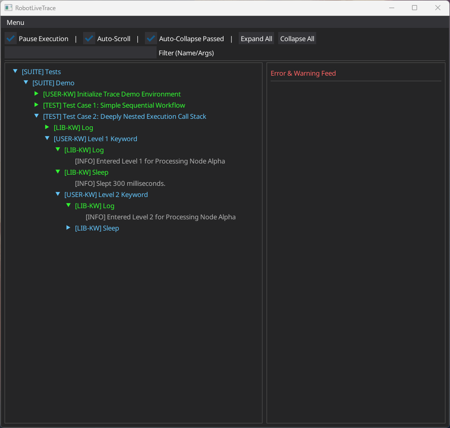

# Robot Framework Live Trace

A real-time, cross-platform test execution visualization for Robot Framework powered by [DearPyGui](https://github.com/hoffstadt/DearPyGui).

> Nothing has such power to broaden the mind as the ability to investigate systematically and truly all that comes under thy observation. - Marcus Aurelius



## Features

* **Live Execution Tree**: Watch your Suites, Tests, Keywords, and control structures such as `FOR` and `IF` expand and collapse in real-time. Keywords that can't be found are shown too, and anything that didn't run is grayed out.
* **Error Feed**: A split-pane chronological feed of all `WARN`, `ERROR`, and `FAIL` logs. Click any error to instantly expand the tree and highlight the exact keyword that caused it.
* **Tooltips**: Hover over any keyword to see its execution time, status, and input arguments.
* **Execution Control**: Pause and resume the active Robot Framework test run directly from the GUI, or pause automatically when a failure happens.
* **Search and Filtering**: Instantly search large execution trees by keyword name, argument, or log message.
* **Process Isolated**: Runs in a separate `multiprocessing` process, dodging the Python GIL and ensuring your test timings are not affected by GUI rendering overhead.

## Requirements

* Python 3.10+
* Robot Framework >= 7.0 *(Requires the V3 Listener API)*
* Dear PyGui >= 2.0

## Installation

Install the package directly from PyPI:

```bash
uv add robotframework-live-trace
```

or using pip:

```bash
pip install robotframework-live-trace

```

### RHEL, Rocky and AlmaLinux 9

Dear PyGui 2.1 and newer need a newer `libstdc++` than these systems ship, so importing them fails with an error like ``version `GLIBCXX_3.4.30' not found``. Install Dear PyGui 2.0.0 instead (available for Python 3.13 and older):

```bash
pip install robotframework-live-trace "dearpygui==2.0.0"
```

## Usage

You do not need to modify your Robot Framework test files. Simply pass the listener to the `robot` command:

```bash
robot --listener RobotLiveTrace my_tests/

```

The Dear PyGui dashboard will open immediately, and the test execution will begin. When the test suite finishes, the window will remain open so you can inspect the final call stack. Close the window to exit robotframework.

## UI Controls

The top control bar provides several ways to manage large test executions:

* **Pause**: Freezes the Robot Framework execution thread. Uncheck to resume.
* **Pause on Failure**: Pauses where a keyword or control structure fails, and checks **Pause** so you can inspect it. Uncheck **Pause** to resume. This includes failures that are handled later, such as by `TRY/EXCEPT` or `Run Keyword And Ignore Error`, because they can't be told apart when they happen.
* **Auto-Scroll**: Automatically scrolls the tree and error feed to the bottom as new keywords and logs arrive.
* **Auto-Collapse Passed**: When a keyword, test or suite finishes with a `PASS` or `NOT RUN` status, it will automatically collapse its tree node to keep the UI clean. Failed nodes will remain expanded.
* **Expand All / Collapse All**: Instantly open or close all currently rendered tree nodes.
* **Filter (Name/Args/Logs)**: Type to instantly hide non-matching keywords. The tree will automatically expand parents to reveal deeply nested matches.

## Contributing

Contributions, issues, and feature requests are welcome. See [CONTRIBUTING.md](CONTRIBUTING.md)

## License

Distributed under the MIT License. See [LICENSE](LICENSE) for more information.

### Third-Party Assets
* **Noto Sans Font**: This package bundles the "Noto Sans" font. The font is licensed under the SIL Open Font License, Version 1.1. The full license text can be found in [src/RobotLiveTrace/fonts/OFL.txt](src/RobotLiveTrace/fonts/OFL.txt).